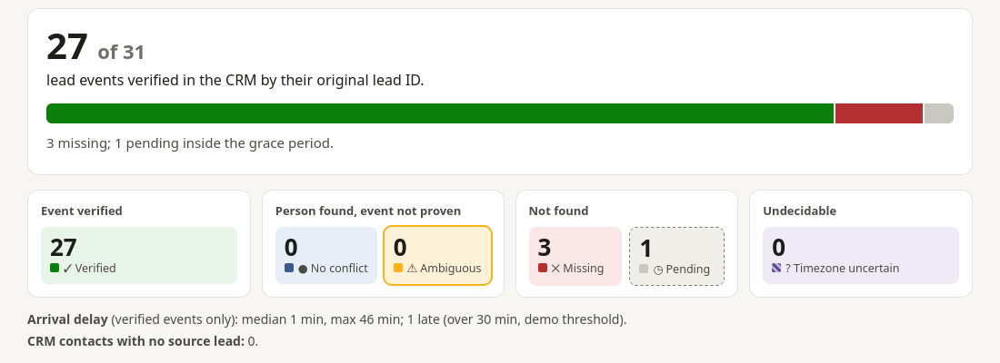
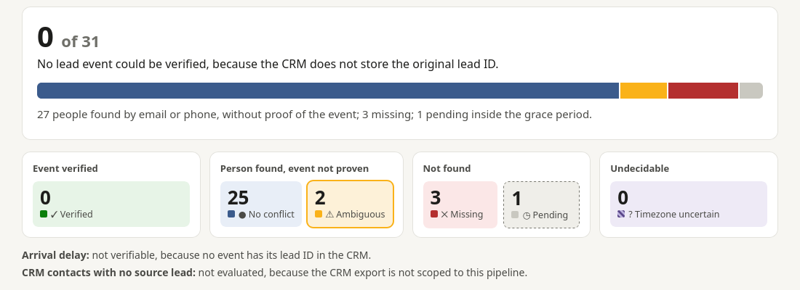
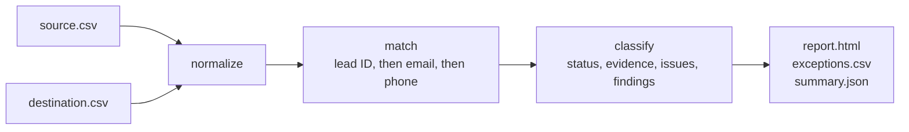

# Lead Integrity

[](https://github.com/chacalra/lead-integrity/actions/workflows/tests.yml)
[](LICENSE)

Record-level reconciliation between a lead source and a CRM: did every lead arrive, and can you prove it?

> **Status:** proof of concept. Synthetic data, local CSV exports, no live integrations. Not production-ready.

## The problem

Leads from ad platforms reach CRMs through native integrations, Zapier, Make, n8n or custom code. When something goes wrong, the automation often still reports success: a lead never arrives, arrives twice, loses its campaign attribution, or lands hours late.

Workflow monitoring answers **"did the automation run?"**
Lead Integrity explores a different question: **"did every business record actually arrive correctly?"**

It compares a source export (for example, a Meta Lead Ads form export) with a CRM export record by record, and explains every mismatch: what happened, why we say so, and how certain the conclusion is.

## Verified events versus identity matches

Finding the person in the CRM is not the same as proving that a specific lead reached it.

| Evidence | What it proves | Based on |
|---|---|---|
| **Verified event** | This lead event reached the CRM | The CRM record stores the lead's original ID |
| **Identity match** | The person exists in the CRM; this lead is not proven | Same email or phone number |
| **None** | Nothing | No match |

The distinction matters because an identity match can hide a lost lead. If someone submits two forms and the CRM shows one contact, the person exists, but there is no evidence that both leads were processed. Lead Integrity reports that case as **ambiguous**, not as success. It also refuses to claim delays or lateness without a verified event, and it says "undecidable" instead of guessing when timestamps are not comparable.

## Same source data, two pipelines

Scenarios A and B use **the same 31 source leads**. The only difference is whether the CRM stores the original lead ID.

| A. The CRM stores the lead ID | B. The CRM does not store the lead ID |
|---|---|
|  |  |
| 27 of 31 events verified. Arrival delay measured (median 1 min, 1 late). 3 missing, 1 still in the grace period. | 0 of 31 events verifiable. 27 people found by email or phone, 2 of them ambiguous. Delay not verifiable. The same 3 leads missing. |

Both pipelines lose the same three leads, and both reports find them. Only A can prove that the other 27 arrived.

Which of the two you get depends on the integration. [Integration traceability](docs/integration-traceability.md) reviews what public documentation says about HubSpot, Zapier, Make, GoHighLevel, Kommo and Pipedrive.

## Quickstart

Requires Python 3.12+ and [uv](https://docs.astral.sh/uv/).

```bash
git clone https://github.com/chacalra/lead-integrity.git
cd lead-integrity
uv sync
uv run pytest                            # 97 tests
uv run python scripts/build_reports.py   # writes reports/<scenario>/
```

Then open `reports/a-lead-id-preserved/report.html` and `reports/b-lead-id-not-preserved/report.html` side by side. Each scenario folder also contains `exceptions.csv` and `summary.json`.

## Scenarios

Eight synthetic scenarios are included. The four that show the core ideas:

| Scenario | What it demonstrates |
|---|---|
| **A** `a-lead-id-preserved` | Deterministic verification, measured latency, missing and late leads |
| **B** `b-lead-id-not-preserved` | The same leads without lead IDs: identity only, nothing provable |
| **D** `d-timezone-uncertain` | A misdeclared timezone is detected; time-based conclusions are switched off instead of guessed |
| **H** `h-campaign-id-never-sent` | A field the pipeline never sends becomes one finding, not 25 errors |

The others cover the same person submitting twice, verified duplicates, preexisting contacts, and excluded test leads. See [`examples/`](examples/README.md).

## What it detects

- **Per lead:** verified, missing, pending (inside the grace period), duplicated, merged, identity match, ambiguous (record claimed by another lead, shared by several leads, several candidates, or created before the lead), undecidable, excluded.
- **Per matched record:** late arrival, missing or mismatched campaign attribution, changed email or phone, invalid phone numbers.
- **Per dataset:** lead IDs not preserved, a field never transmitted, timezone inconsistency, and CRM records with no source lead (only when the CRM export is scoped to the pipeline).

The full semantics are in [`docs/reconciliation-model.md`](docs/reconciliation-model.md).

## How it works



| Module | Responsibility |
|---|---|
| `load.py` | Reads CSV exports through a configurable column map |
| `normalize.py` | Emails, phone numbers (E.164 via `phonenumbers`), IDs, timestamps to UTC |
| `reconcile.py` | Matching cascade, statuses, issues and dataset-level findings |
| `report.py` | Business-readable HTML report, exceptions CSV, JSON summary |
| `config.py` | Loads a run definition (`run.toml`) |
| `models.py` | Typed records, settings and outcomes |

Pure Python standard library plus one runtime dependency (`phonenumbers`). No database, no web framework.

## Scope and limitations

- **Proof of concept.** It runs on local CSV exports. There are no API integrations, no continuous monitoring, and no remediation.
- **Synthetic data only.** Emails use RFC 2606 example domains and phone numbers use the 555-01xx fictional range.
- **Export formats are modeled, not verified.** The layouts follow public documentation and descriptions of Meta Lead Ads and CRM exports; real exports may differ in columns, date formats or timezones.
- **Thresholds are illustrative.** Late, grace-period and systemic thresholds are demo values in [`examples/base-config.toml`](examples/base-config.toml). Normal delay depends on each pipeline.
- **It does not establish how often these problems occur** in real pipelines, or what they cost.

## Project status

The reconciliation model and its test suite are stable. Further work would start from real exports, to validate the format assumptions and the timezone heuristic.

## License

Copyright 2026 Ramon Chacal. Licensed under the [Apache License 2.0](LICENSE).
